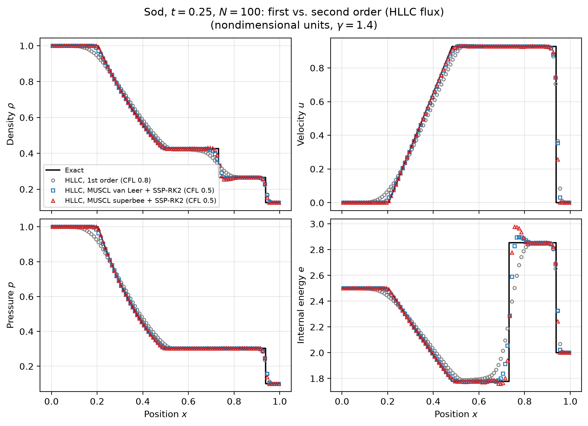
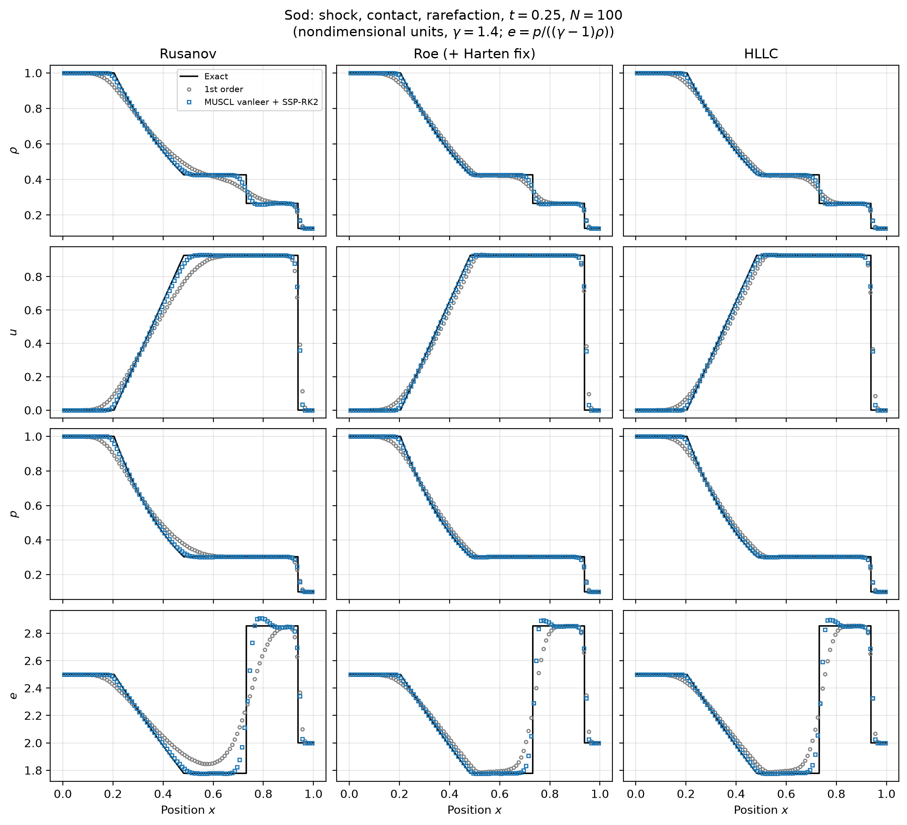
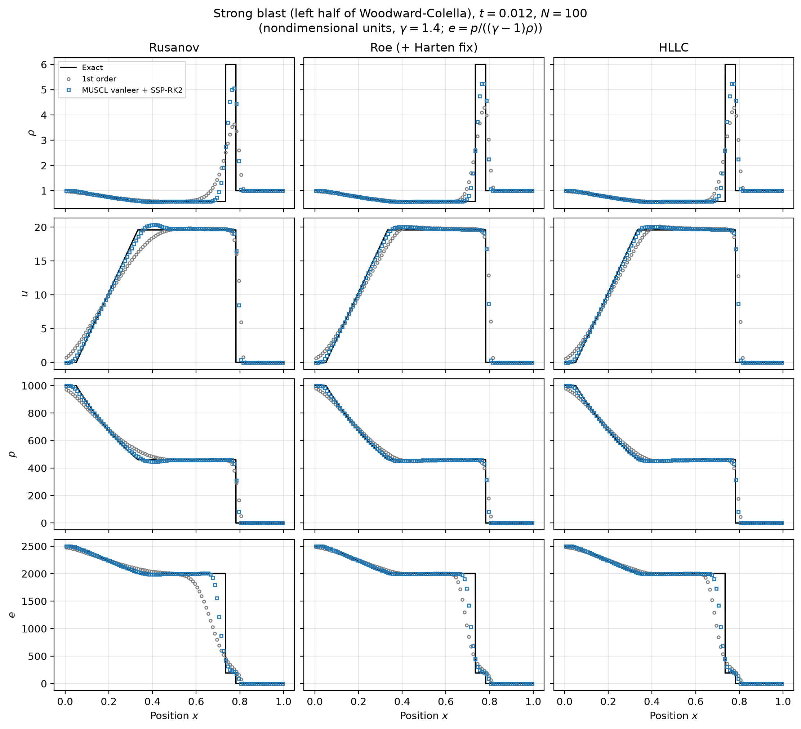
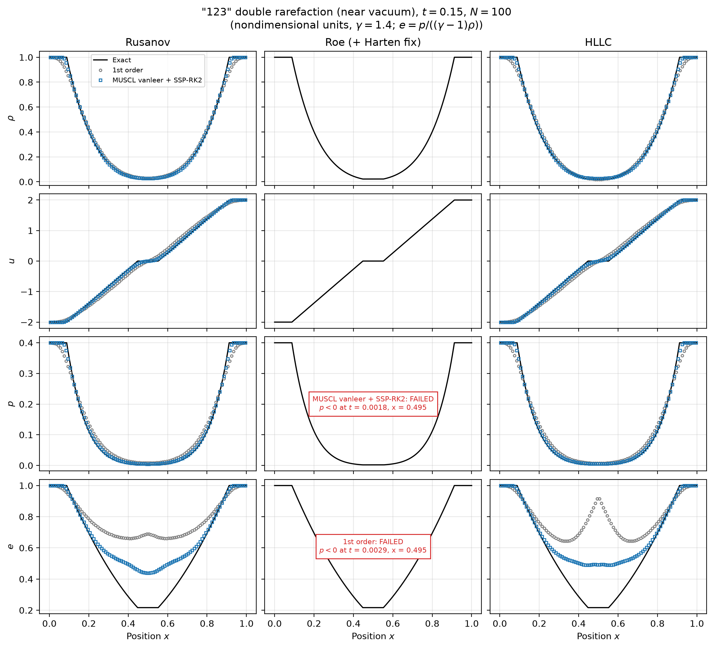
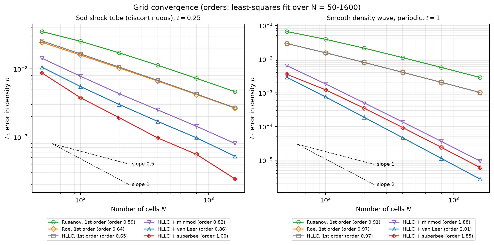
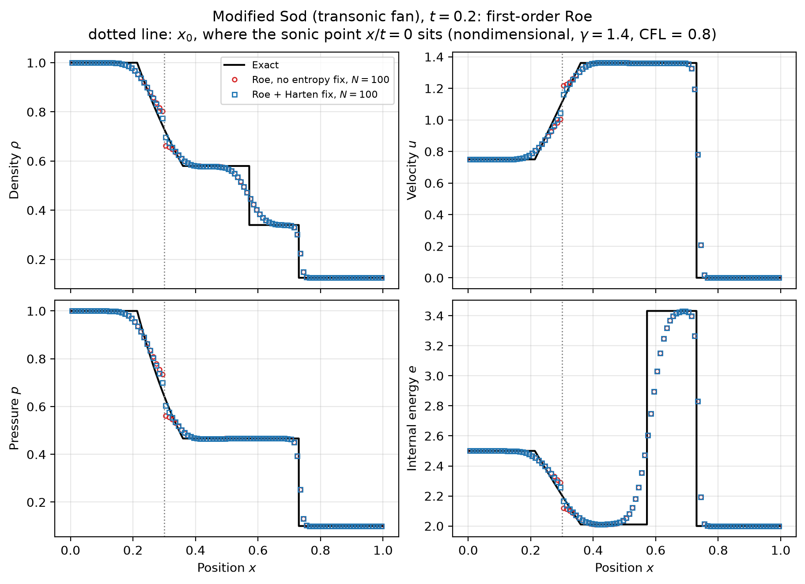
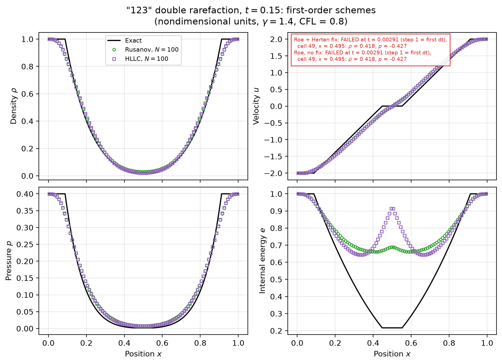
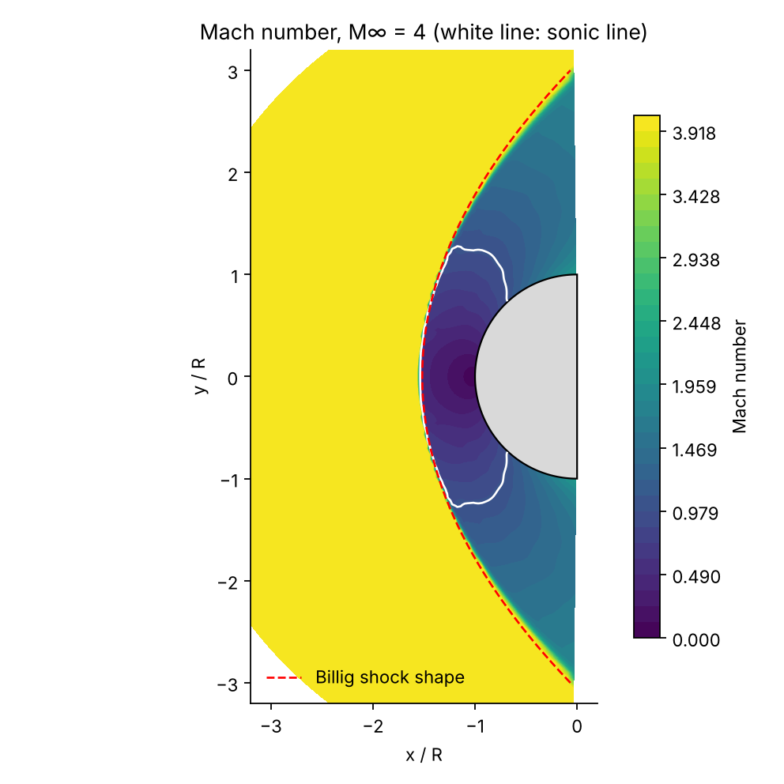
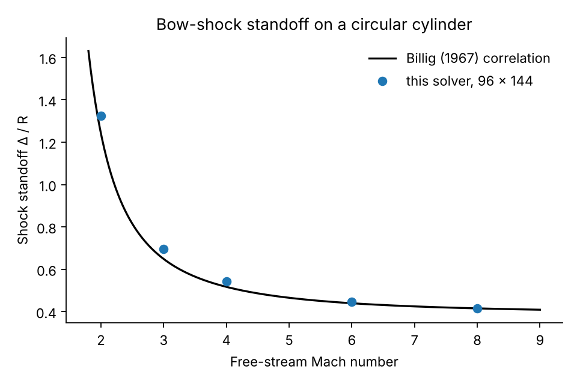

# Euler Solver: Shock Tube & 2D Blunt Body

**[▶ Try it in your browser](https://badrelsayednyu.github.io/shock-tube-solver/)** — interactive version that runs the same models live: the 1D shock tube and the [2D blunt body](https://badrelsayednyu.github.io/shock-tube-solver/#blunt-body).

**[1D numerical studies](https://badrelsayednyu.github.io/shock-tube-solver/studies.html)** runs grid convergence, all 12 flux/limiter combinations, and mass, momentum and energy budgets with CSV export. Conservation uses time-integrated boundary fluxes with the same stage weights as the solver; failed runs are reported without final-time error metrics. The studies reuse the lab solver, extracted by `python scripts/build_studies_core.py`, with 15 additional browser-model tests (`node --test tests/test_browser_studies.cjs`).

A finite-volume, shock-capturing solver for the one-dimensional compressible Euler equations, validated against an exact Riemann solver. It compares three numerical fluxes (Rusanov, Roe, HLLC) and four reconstructions (first order, minmod, van Leer, superbee) for accuracy, convergence, cost, and how sharply each one resolves shocks, contact discontinuities and expansion fans. It also documents two well-known ways the Roe solver fails.

*Badr Elsayed. Python 3.11+ / NumPy, fully vectorized; 65 automated tests (57 for the 1D solver, 8 for the 2D blunt-body extension).*



## Motivation

Supersonic and hypersonic flows are full of discontinuities: bow shocks ahead of reentry vehicles, shock trains in scramjet isolators, contact surfaces between fuel and air. A CFD code for these flows has to capture such features without being told where they are, without spurious oscillations, and without producing negative densities or pressures. Most modern compressible-flow solvers, from 2D airfoil codes to 3D hypersonic vehicle codes, are built on the core component this project studies: an approximate Riemann solver that turns the cell-averaged states on either side of a face into a flux. The 1D shock tube is the standard setting for testing that core, because its exact solution is known, so each scheme's error can be measured directly rather than judged by eye.

## Governing equations

For a calorically perfect gas (γ = 1.4) the 1D Euler equations in conservation form are

$$
\frac{\partial \mathbf U}{\partial t} + \frac{\partial \mathbf F(\mathbf U)}{\partial x} = 0,\qquad
\mathbf U = \begin{bmatrix}\rho\\ \rho u\\ E\end{bmatrix},\qquad
\mathbf F = \begin{bmatrix}\rho u\\ \rho u^2 + p\\ u(E+p)\end{bmatrix},
$$

with total energy $E = p/(\gamma-1) + \tfrac12\rho u^2$, sound speed $a = \sqrt{\gamma p/\rho}$ and total enthalpy $H = (E+p)/\rho$. All quantities are nondimensional.

### The Riemann problem

A Riemann problem is the initial-value problem with two constant states separated by a single discontinuity at $x_0$. Its solution is self-similar, a function of $x/t$ only, and consists of three waves: a left-facing acoustic wave (shock or rarefaction), a contact discontinuity moving at the fluid velocity, and a right-facing acoustic wave. Pressure and velocity are continuous across the contact, so the two "star" states between the acoustic waves share a single $p^*$ and $u^*$. Across each acoustic wave, $u$ is a known function of $p$: the Rankine–Hugoniot relations if it is a shock ($p^* > p_K$), and the isentropic Riemann invariant if it is a rarefaction ($p^* \le p_K$). Requiring the velocities from the two sides to match gives one scalar equation for $p^*$,

$$
f(p) = f_L(p) + f_R(p) + (u_R - u_L) = 0,
$$

$$
f_K(p) = \begin{cases}
(p - p_K)\sqrt{\dfrac{A_K}{p + B_K}}, & p > p_K \ \text{(shock)},\quad A_K = \dfrac{2}{(\gamma+1)\rho_K},\ B_K = \dfrac{\gamma-1}{\gamma+1}p_K\\[2ex]
\dfrac{2a_K}{\gamma-1}\left[\left(\dfrac{p}{p_K}\right)^{\frac{\gamma-1}{2\gamma}} - 1\right], & p \le p_K \ \text{(rarefaction)}
\end{cases}
$$

which is solved by Newton iteration to a relative tolerance of $10^{-8}$; then $u^* = \tfrac12(u_L+u_R) + \tfrac12[f_R(p^*) - f_L(p^*)]$. The full solution at any $x/t$, including inside the rarefaction fans, follows from the wave speeds (Toro, ch. 4). This exact solver is the reference for every error reported below. It reproduces Toro's tabulated star states (Sod: $p^* = 0.30313$, $u^* = 0.92745$; Test 3: $p^* = 460.894$, $u^* = 19.5975$), and the tests also check the Rankine–Hugoniot conditions across the computed shock and isentropy inside the fans.

## Numerical method

**Finite-volume update.** On a uniform grid of $N$ cells on $[0, 1]$,

$$
\frac{d\mathbf U_i}{dt} = -\frac{\mathbf F_{i+1/2} - \mathbf F_{i-1/2}}{\Delta x},
$$

where the face flux $\mathbf F_{i+1/2} = \mathcal F(\mathbf W^L_{i+1/2}, \mathbf W^R_{i+1/2})$ comes from a numerical flux applied to the primitive states $\mathbf W = (\rho, u, p)$ on either side of the face. The time step is $\Delta t = C\,\Delta x / \max_i(|u_i| + a_i)$, with CFL number $C = 0.8$ at first order and $0.5$ at second order, and the last step is shortened to land exactly on the output time. Boundaries are transmissive (zero-gradient ghost cells) or periodic. After every stage the solver checks $\rho > 0$ and $p > 0$ in every cell, and stops with the cell, position and time if either fails, instead of letting NaNs spread.

### Numerical fluxes

| Flux | Idea | Strength | Weakness |
|---|---|---|---|
| **Rusanov** (local Lax–Friedrichs) | Central flux plus dissipation scaled by the fastest local wave speed, $S_{\max} = \max(\lvert u\rvert + a)$ | Simplest; robust; positivity-preserving | Applies acoustic-speed dissipation to every wave, so contacts smear badly |
| **Roe** (with Harten entropy fix) | Exact solution of a locally linearized problem built from Roe-averaged states; each of the three waves gets its own dissipation $\lvert\lambda_i\rvert$ | Sharp shocks and contacts; resolves a stationary contact exactly | Can produce non-physical expansion shocks at sonic points; not positivity-preserving |
| **HLLC** | Two-wave HLL fan (Einfeldt speed estimates) with the missing contact wave restored, giving two intermediate states | Resolves contacts as sharply as Roe; no entropy fix needed; robust near vacuum | Slightly more arithmetic per face |

The Harten fix replaces $\lvert\lambda\rvert$ by $(\lambda^2 + \delta^2)/(2\delta)$ when $\lvert\lambda\rvert < \delta = 0.1\,\tilde a$, applied only to the acoustic waves $\lambda_{1,3} = \tilde u \mp \tilde a$, never to the contact.

### Second order: MUSCL reconstruction and SSP-RK2

Primitive variables are reconstructed linearly within each cell, $\mathbf W_{i\pm 1/2} = \mathbf W_i \pm \tfrac12\Delta_i$, with the limited slope

$$
\Delta_i = \phi(r_i)\,(\mathbf W_i - \mathbf W_{i-1}),\qquad r_i = \frac{\mathbf W_{i+1} - \mathbf W_i}{\mathbf W_i - \mathbf W_{i-1}}.
$$

| Limiter | $\phi(r)$ | Character |
|---|---|---|
| none | $0$ | First order |
| minmod | $\max(0, \min(1, r))$ | Most diffusive; clips smooth extrema |
| van Leer | $(r + \lvert r\rvert)/(1 + \lvert r\rvert)$ | Smooth; a balanced middle ground |
| superbee | $\max(0, \min(2r, 1), \min(r, 2))$ | Most compressive; sharpest discontinuities, can square off smooth waves |

All three limiters satisfy Sweby's TVD conditions $0 \le \phi(r) \le \min(2r, 2)$, which the tests verify. Time integration uses the two-stage strong-stability-preserving Runge–Kutta scheme (Heun's method). As a safety net, any cell whose reconstructed face density or pressure would be non-positive falls back to first order.

## Validation and results

All figures and tables below are regenerated by `python scripts/make_figures.py`.

| Case | $\rho_L$ | $u_L$ | $p_L$ | $\rho_R$ | $u_R$ | $p_R$ | $x_0$ | $t$ | What it tests |
|---|---|---|---|---|---|---|---|---|---|
| 1. Sod | 1 | 0 | 1 | 0.125 | 0 | 0.1 | 0.5 | 0.25 | Shock, contact, rarefaction |
| 2. "123" | 1 | −2 | 0.4 | 1 | 2 | 0.4 | 0.5 | 0.15 | Two strong rarefactions, near-vacuum center |
| 3. Strong blast | 1 | 0 | 1000 | 1 | 0 | 0.01 | 0.5 | 0.012 | Pressure ratio 10⁵, thin dense shell |
| 4. Modified Sod | 1 | 0.75 | 1 | 0.125 | 0 | 0.1 | 0.3 | 0.2 | Transonic (sonic-point) rarefaction |

### 1. Scheme overlays against the exact solution



On Sod (N = 100), every scheme places all three waves correctly. The differences are in sharpness: first-order Rusanov rounds the fan corners and spreads the contact over about a fifth of the domain, while Roe and HLLC at first order already resolve the contact noticeably better. Adding van Leer reconstruction brings all three to within a few cells of the exact profile. The internal energy $e = p/((\gamma-1)\rho)$ is the most revealing variable, because it jumps at the contact while pressure does not.



The strong blast is a robustness test: a pressure ratio of 10⁵ drives a shock with a dense shell ($\rho \approx 6$) only about 5 cells wide at N = 100. Every flux–limiter combination completes it. At N = 100 second order reaches $\rho \approx 5.2$ in the shell, against about 4.3 for first-order Roe and HLLC and about 3.6 for first-order Rusanov. Rusanov with van Leer shows a small velocity overshoot (about 20.3 against 19.6) at the tail of the fan.



On the 123 problem, Rusanov and HLLC capture density, velocity and pressure well. Roe fails at both orders (see §5). All surviving schemes overestimate the internal energy in the near-vacuum center, because $e$ is a ratio of two very small numbers and amplifies their errors. Second order cuts that error roughly in half or better. Toro notes the same difficulty with internal energy on this test.

Overlays for Case 4 are in [figures/overlay_modsod.png](figures/overlay_modsod.png).

### 2. Grid convergence



On Sod (left), the observed $L_1$ order of the density error is 0.59–0.65 for the first-order schemes and 0.82–1.00 for the second-order ones, below their formal orders of 1 and 2. This is expected, and it is not a bug: the smooth-wave test on the right shows the same code reaching its formal orders (0.97 first order, 2.01 with van Leer). Near a discontinuity the local error is O(1) in a band a few cells wide, so its $L_1$ contribution can shrink no faster than $\Delta x$, which caps every scheme at order 1. The contact discontinuity is the worst case: a contact is a linearly degenerate wave that does not self-steepen, so first-order dissipation spreads it over a width that grows like $\sqrt{t\,\Delta x}$, which produces the order-½ behavior visible in the first-order curves. Shocks are self-steepening and stay a fixed 2–4 cells wide (see §4). Superbee's compressive slopes counteract the contact spreading best, which is why Roe and HLLC with superbee are the only combinations that reach order 1 on Sod.

### 3. Scheme comparison (Sod, N = 400)

Sod, N = 400, t = 0.25. Runtime: median of 7 runs on one CPU core (first order: forward Euler, CFL 0.8; second order: SSP-RK2, CFL 0.5). Cells across a discontinuity: cells inside the 5-95% band of the jump (shock measured in p, contact in rho).

| Flux | Limiter | L1 error (rho) | Runtime (ms) | Steps | Cells across shock | Cells across contact |
|---|---|---|---|---|---|---|
| rusanov | none | 1.126e-02 | 14.7 | 272 | 4 | 49 |
| rusanov | minmod | 3.141e-03 | 44.1 | 437 | 4 | 17 |
| rusanov | vanleer | 2.089e-03 | 44.6 | 438 | 3 | 10 |
| rusanov | superbee | 1.838e-03 | 48.0 | 445 | 2 | 4 |
| roe | none | 6.609e-03 | 21.3 | 273 | 4 | 28 |
| roe | minmod | 2.457e-03 | 65.4 | 437 | 4 | 13 |
| roe | vanleer | 1.606e-03 | 66.4 | 438 | 3 | 9 |
| roe | superbee | **9.002e-04** | 69.8 | 442 | 2 | 4 |
| hllc | none | 6.758e-03 | 24.7 | 273 | 4 | 28 |
| hllc | minmod | 2.497e-03 | 75.4 | 437 | 4 | 13 |
| hllc | vanleer | 1.692e-03 | 75.4 | 438 | 3 | 9 |
| hllc | superbee | 9.686e-04 | 79.7 | 442 | 2 | 3 |

The limiter matters much more than the flux. Going from first order to superbee reduces the error by 6–7 times, while switching between Roe and HLLC changes it by less than 10%. Rusanov is consistently the least accurate, about 1.7 times the Roe/HLLC error at first order, but its simpler formula makes it 30–40% cheaper per step. Second order costs about 3 times as much as first order (two flux evaluations per step, and about 1.6 times as many steps at the smaller CFL number). Every run takes under a tenth of a second, so in 1D the accuracy gain is far more significant than the cost.

### 4. Discontinuity resolution

The table above also counts the cells inside the 5–95% band of each jump: pressure for the shock, density for the contact. The **shock** is 2–4 cells wide for every scheme and at every resolution, because converging characteristics keep re-steepening it, so the choice of flux barely matters there. The **contact** is where the schemes separate: at first order, HLLC needs 28 cells against Rusanov's 49, because Rusanov applies dissipation scaled by $\lvert u\rvert + a$ to a wave that moves at only $u$, while HLLC and Roe treat the contact as a wave of its own. With superbee, Roe and HLLC hold the contact to 3–4 cells. The first-order contact also widens with resolution (Rusanov: 23 cells at N = 100, 49 at N = 400), matching the $\sqrt{N}$ growth predicted above.

### 5. Two ways the Roe solver fails

**(a) Expansion shock at a sonic point (Case 4).** In Case 4 the left rarefaction is transonic: its head moves left (x/t = −0.43) and its tail moves right (x/t = +0.30), so one acoustic eigenvalue passes through zero inside the fan. There the Roe dissipation $\lvert\lambda_1\rvert$ vanishes, and the linearized solver happily keeps an entropy-violating discontinuity, an "expansion shock".



Modified Sod (Case 4), first order, N = 100, t = 0.2. Density drop between the two cells adjacent to x0 = 0.3 (the sonic point).

| Scheme | Density drop at sonic point | L1 error (rho) |
|---|---|---|
| Exact solution (sampled at the two cell centers) | 0.0274 | - |
| Roe, no entropy fix | 0.1400 | 1.455e-02 |
| Roe + Harten fix, delta = 0.1 a~ (default) | 0.0775 | 1.347e-02 |
| Roe + Harten fix, delta = 0.2 a~ | 0.0386 | 1.286e-02 |
| Roe + Harten fix, delta = 0.3 a~ | 0.0301 | 1.315e-02 |
| HLLC | 0.0273 | 1.380e-02 |
| Rusanov | 0.0163 | 2.961e-02 |

Without the fix, Roe produces a jump about 5 times larger than the exact change across those two cells. The Harten fix with the default $\delta = 0.1\tilde a$ roughly halves the jump but leaves a visible kink. Widening it to $0.2$–$0.3\,\tilde a$ essentially removes it, at the cost of extra dissipation at every sonic point. HLLC matches the exact drop with no tuning: its wave-speed estimates satisfy $S_L < 0 < S_R$ at a sonic point, so its dissipation never vanishes there.

**(b) Loss of positivity near vacuum (Case 2, "123").** Two strong rarefactions pull the center toward vacuum. Roe fails on the **very first time step**: the cell next to the diaphragm reaches $p = -0.43$ while $\rho = 0.42$ is still positive. The failure is identical with and without the entropy fix. The fix only activates for $\lvert\lambda\rvert < \delta$, and here the acoustic speeds are $\pm 1.17$, an order of magnitude larger than $\delta \approx 0.12$. This is not an entropy problem; it is a known limitation of linearized Riemann solvers (Einfeldt et al., 1991): for sufficiently strong rarefactions, the linearized intermediate states have negative pressure or density, whatever entropy fix is applied. Rusanov and HLLC, whose wave-speed estimates bound the true signal speeds, complete the run.



### Additional verification

- **Conservation.** With periodic boundaries, total mass, momentum and energy stay constant to about $10^{-16}$ for every scheme tested. With transmissive boundaries the system is open, and the change in each total matches the time-integrated boundary flux to round-off. For SSP-RK2 the boundary fluxes are accumulated with the same stage weights as the update; without that, the budget does not close.
- **Flux properties.** Each flux reduces to the physical flux for identical states. Roe reproduces pure upwinding when all waves move one way. Roe and HLLC hold a stationary contact exactly, and Rusanov visibly does not.
- **Positivity fallback.** In all 33 completed second-order runs (four cases × three fluxes × three limiters at N = 400, minus Roe on the 123 problem), including the strong blast, the reconstruction fallback triggered **zero** times. This is expected rather than lucky: the TVD condition $\phi \le \min(2r, 2)$ keeps every reconstructed face value between the neighboring cell averages, so positive data stay positive. The fallback is tested directly with forced inputs and remains as a safeguard for less constrained reconstructions such as WENO.
- **Limiter side effect.** Each primitive variable is limited separately, so derived quantities such as $e = p/((\gamma-1)\rho)$ are not bounded. Superbee overshoots $e$ just behind the Sod contact by about 5% at N = 100 (visible in the figure at the top of this page).

## Extension: supersonic flow over a cylinder (2D)

The same building blocks (MUSCL reconstruction, approximate Riemann fluxes, SSP-RK2) are extended to two dimensions in `src/shocktube/blunt2d.py` to solve the **blunt-body problem**: a detached bow shock stands ahead of a circular cylinder, with a subsonic pocket at the nose and supersonic flow around the shoulders. This is the flow in my research on extending a strongly implicit method to supersonic blunt bodies, so this solver also serves as an independent reference for it.



**[▶ Run it in your browser](https://badrelsayednyu.github.io/shock-tube-solver/#blunt-body):** pick a Mach number, flux and grid, watch the bow shock form, and compare the result with Billig and the pitot formula. The carbuncle case below is one click.

**Method.** Cell-centred finite volume on a body-fitted polar grid over the windward half of the cylinder (radial cells clustered at the wall), with face vectors from node differences so uniform flow is preserved to round-off. Face states come from van Leer–limited MUSCL reconstruction in each grid direction, rotated into the face-normal frame for the flux. Boundaries: slip wall, free stream on the outer arc, supersonic outflow on the plane x = 0. A first-order phase sets up the shock, then the second-order scheme is marched to steady state with local time steps.

**What it is validated against.**
- **Stagnation pressure vs. the exact Rayleigh pitot formula.** Behind a normal shock the flow decelerates isentropically to the stagnation point, so the wall pressure there has an exact value for an inviscid perfect gas. This is the solver's exact check.
- **Shock standoff vs. Billig's correlation**, Δ/R = 0.386 exp(4.67/M∞²) (Billig, 1967). This is a curve fit to experimental data, not an exact solution, so agreement within a few percent is the realistic target.
- **Grid independence**, checked on three grids at M = 3.

| M∞ | Standoff Δ/R | Billig | Difference | p₀/p∞ | Pitot (exact) | Difference |
|---|---|---|---|---|---|---|
| 2 | 1.325 | 1.241 | +6.8% | 5.64 | 5.64 | +0.02% |
| 3 | 0.697 | 0.649 | +7.4% | 12.04 | 12.06 | −0.15% |
| 4 | 0.541 | 0.517 | +4.7% | 21.05 | 21.07 | −0.10% |
| 6 | 0.445 | 0.439 | +1.3% | 46.74 | 46.82 | −0.16% |
| 8 | 0.416 | 0.415 | +0.1% | 81.66 | 82.87 | −1.45% |

96 × 144 grid, HLL flux with van Leer reconstruction. Full tables, including the grid study, are in [results/blunt_body.md](results/blunt_body.md).



The stagnation pressure matches the exact value to 0.2% or better up to M = 6. The standoff distance is grid-independent (0.703, 0.701 and 0.697 on 32 × 48, 64 × 96 and 128 × 192 grids at M = 3) and lies above Billig's correlation by about 7% at M = 2–3, closing to within 1–2% at M = 6–8. Because refinement does not move it, the remaining gap at low Mach number is a difference between this inviscid model and the experimental correlation rather than a discretization error. At M = 8 the residual stalls before the convergence target and the stagnation pressure is 1.5% low, so that point is less reliable than the others.

**A 2D failure mode: HLLC and the carbuncle.** HLLC was the best flux in 1D, but on the blunt body at M = 6 it never converges: the residual stalls near 3 × 10⁻², a disturbance appears along the stagnation line just behind the shock, and the stagnation pressure comes out 4.5% above the exact value. This is the start of the well-known carbuncle instability of contact-resolving fluxes at strong, grid-aligned shocks. HLL, which has no contact wave and is more dissipative there, converges cleanly to −0.16% on the same case. The 2D default is therefore HLL; a practical next step is a hybrid that switches HLLC to HLL only near strong shocks.

```bash
python scripts/blunt_body.py --quick   # coarse grid study + Mach sweep, ~3 min
python scripts/blunt_body.py           # full grid study + Mach sweep, ~25 min
```

## Takeaways

**Which scheme I would choose: HLLC with van Leer reconstruction and SSP-RK2.** HLLC matches Roe's accuracy on every test that both complete (within 10% in L1, and contact widths within one cell) and was the only sharp-contact flux that survived all four problems: it needs no entropy fix at sonic points and stays positive near vacuum, where Roe breaks on its first step. Among the limiters, superbee gives the lowest error on Sod, but it does so by over-steepening. It squares off smooth profiles (its order on the smooth wave is 1.85 against van Leer's 2.01) and overshoots internal energy at contacts. Van Leer is the better default when the solution mixes smooth regions and discontinuities, which is the situation in real aerodynamic flows. Rusanov remains useful as a fallback flux in the strongest shocks because it is the most dissipative and the simplest, but its contact smearing rules it out as the primary flux in this comparison.

**What I would build next.**
1. **Quasi-1D nozzle flow:** add the area-variation source term and capture a normal shock in a converging–diverging nozzle, validated against the isentropic and normal-shock relations. This is the first step toward internal-flow problems such as inlets and scramjet isolators.
2. **More two-dimensional problems:** the blunt-body extension above is a start; next are oblique shocks on a supersonic wedge, the double Mach reflection, and a hybrid HLLC/HLL flux that avoids the carbuncle.
3. **Higher order:** WENO5 reconstruction compared against MUSCL, plus the Shu–Osher shock/entropy-wave problem, where resolving small-scale structure behind a shock separates the schemes.
4. **Real-gas effects:** a variable-γ or equilibrium-air equation of state, which matters in hypersonic flow (roughly Mach 5 and above), where vibrational excitation and dissociation break the calorically perfect gas assumption.

## Reproducing the results

```bash
python -m venv .venv && source .venv/bin/activate
pip install -e ".[dev]"
pytest                                   # 65 tests
python scripts/make_figures.py           # every figure in figures/ and table in results/ (~30 s)
python scripts/run_case.py --case sod --flux hllc --limiter vanleer --N 400 --plot sod.png
```

```
src/shocktube/
  gas.py             conversions between primitive and conserved variables, sound speed, physical flux
  exact.py           exact Riemann solver (Newton iteration for p*) and x/t sampling
  fluxes.py          Rusanov, Roe (+ Harten fix), HLLC
  reconstruction.py  MUSCL, limiters, positivity fallback
  solver.py          finite-volume loop, CFL, boundary conditions, forward Euler / SSP-RK2
  analysis.py        L1 error, observed order, discontinuity widths
  cases.py           test-case definitions
scripts/             run_case.py, convergence.py, comparison.py, make_figures.py
tests/               exact solver, conservation, fluxes, reconstruction, analysis
```

## References

- E. F. Toro, *Riemann Solvers and Numerical Methods for Fluid Dynamics: A Practical Introduction*, 3rd ed., Springer, 2009.
- G. A. Sod, "A survey of several finite difference methods for systems of nonlinear hyperbolic conservation laws," *J. Comput. Phys.* 27, 1–31 (1978).
- P. L. Roe, "Approximate Riemann solvers, parameter vectors, and difference schemes," *J. Comput. Phys.* 43, 357–372 (1981).
- A. Harten, "High resolution schemes for hyperbolic conservation laws," *J. Comput. Phys.* 49, 357–393 (1983).
- B. Einfeldt, "On Godunov-type methods for gas dynamics," *SIAM J. Numer. Anal.* 25, 294–318 (1988).
- B. Einfeldt, C. D. Munz, P. L. Roe, B. Sjögreen, "On Godunov-type methods near low densities," *J. Comput. Phys.* 92, 273–295 (1991).
- E. F. Toro, M. Spruce, W. Speares, "Restoration of the contact surface in the HLL-Riemann solver," *Shock Waves* 4, 25–34 (1994).
- B. van Leer, "Towards the ultimate conservative difference scheme. V. A second-order sequel to Godunov's method," *J. Comput. Phys.* 32, 101–136 (1979).
- S. Gottlieb, C.-W. Shu, "Total variation diminishing Runge–Kutta schemes," *Math. Comp.* 67, 73–85 (1998).
